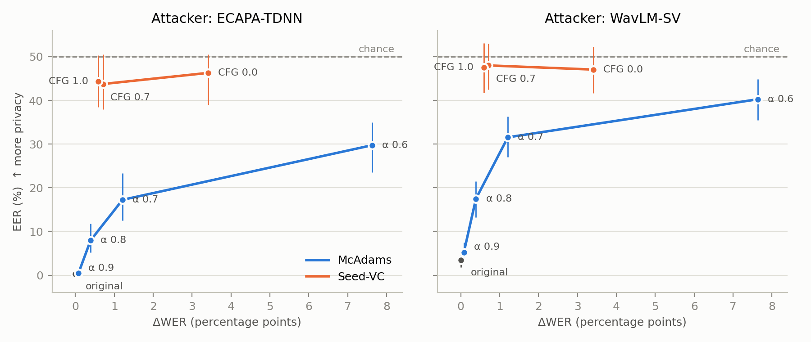
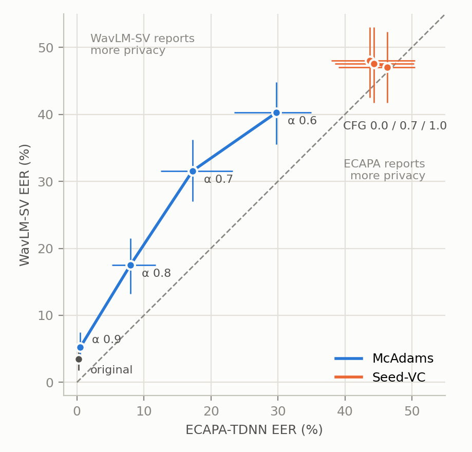
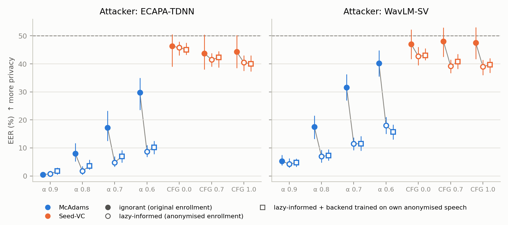
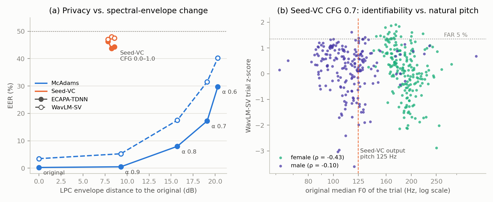
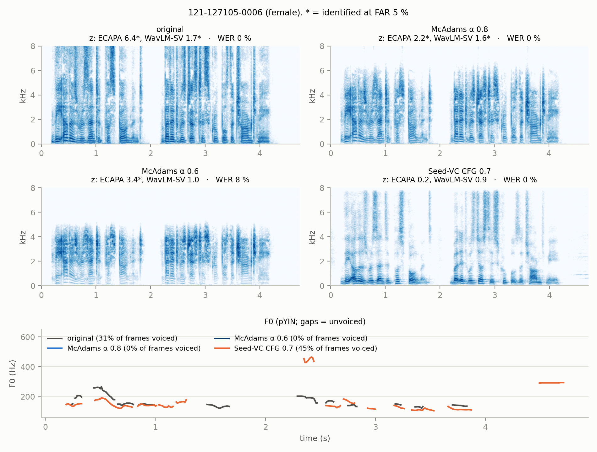
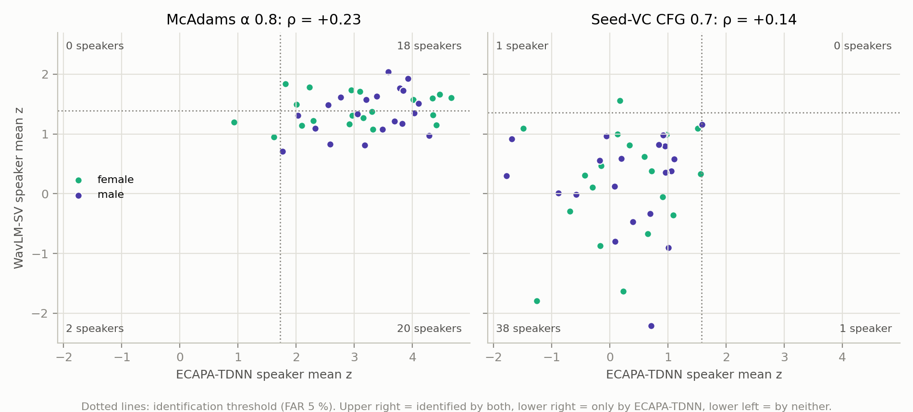

# Privacy–Utility and Attacker Robustness in Classical and Neural Voice Anonymisation

ELEC5305 Project — Shuhuai Wang (SID 550145574) · GitHub: `Max9i/elec5305-project-550145574`

This project compares a classical LPC/McAdams anonymiser (MATLAB) with
pretrained zero-shot neural voice conversion (Seed-VC, Python). It does not
ask which anonymiser is "best". It asks **whether the privacy each one appears
to give still holds when a different speaker-verification attacker is used**,
and how much linguistic and acoustic utility is lost to get that privacy.

> The research question was revised after proposal feedback (see
> [Change log](#change-log)). The original submitted proposal is kept unchanged
> in `ELEC5305_Project_Proposal.pdf`.

---

## Current status

| Milestone | Status |
|---|---|
| M0 Repo setup, revised research question, README | ✅ done |
| M1 Evaluation dataset + original-speech attacker baseline | ✅ done |
| M2 MATLAB LPC/McAdams anonymiser | ✅ done |
| M3 Classical privacy–utility trade-off | ✅ done |
| M4 Seed-VC anonymisation-only mode | ✅ done |
| M5 Attacker comparison (main result) | ✅ done |
| M6 Privacy-failure analysis | ✅ done |
| M7 One optional extension | ✅ D: lazy-informed attacker + adapted backend |
| M8 Report, figures, audio demos, GitHub Pages | ⬜ next |

**Next step:** M8. Write the report from the results below (Figures 1–6),
build the GitHub Pages site with the audio samples, and fill in the
literature list (§13).

**Results so far.** Privacy and utility (`results/summary.csv`; 400
genuine + 7600 impostor pairs; ΔWER = WER − WER(original); RTF = processing
time per second of audio, McAdams on CPU, Seed-VC on GPU):

| Condition | ECAPA EER (%) | WavLM-SV EER (%) | WER (%) | ΔWER | RTF |
|---|---|---|---|---|---|
| original | 0.25 | 3.47 | 1.72 | – | – |
| McAdams α = 0.9 | 0.50 | 5.25 | 1.80 | +0.08 | 0.024 |
| McAdams α = 0.8 | 7.97 | 17.49 | 2.11 | +0.39 | 0.022 |
| McAdams α = 0.7 | 17.25 | 31.55 | 2.93 | +1.21 | 0.022 |
| McAdams α = 0.6 | 29.75 | 40.25 | 9.35 | +7.63 | 0.026 |
| Seed-VC CFG 0.0 | 46.29 | 47.05 | 5.13 | +3.41 | 0.26 |
| Seed-VC CFG 0.7 (default) | 43.75 | 48.00 | 2.43 | +0.71 | 0.25 |
| Seed-VC CFG 1.0 | 44.30 | 47.53 | 2.31 | +0.59 | 0.26 |

Acoustic change against the original (`results/acoustics.csv`; F0
measures are medians over utterances, the others means):

| Condition | F0 shift (semitones) | F0 contour correlation | Voiced frames kept | LPC envelope distance (dB) |
|---|---|---|---|---|
| McAdams α = 0.9 | 0.00 | 0.997 | 72 % | 9.3 |
| McAdams α = 0.8 | 0.00 | 0.996 | 48 % | 15.7 |
| McAdams α = 0.7 | 0.00 | 0.991 | 20 % | 19.1 |
| McAdams α = 0.6 | 0.00 | 0.974 | 7 % | 20.3 |
| Seed-VC CFG 0.0 | −3.43 | 0.450 | 50 % | 7.8 |
| Seed-VC CFG 0.7 | −3.15 | 0.421 | 58 % | 8.2 |
| Seed-VC CFG 1.0 | −2.95 | 0.367 | 58 % | 8.6 |

### M5 main result: do the two attackers agree?




`python/plot_m5.py`. The 95 % intervals (error bars, `results/eer_ci.csv`)
come from a speaker bootstrap: 1000 draws of 20 F + 20 M trial speakers
with replacement. The same draws are used for every condition and attacker,
so differences between conditions are paired.

**Same ranking.** Kendall τ between the two attackers' rankings of the 8
conditions is 0.79. Both order the conditions original < McAdams α 0.9 <
0.8 < 0.7 < 0.6 < every Seed-VC setting. The only order differences are
among the three Seed-VC settings, and none is robust: only 60–78 % of
bootstrap draws agree on any of them. Both attackers find the Seed-VC
settings statistically indistinguishable.

**Different privacy level for McAdams.**
- WavLM-SV reports more privacy than ECAPA everywhere. On original speech
  the gap is +3.2 EER points (95 % CI 1.8 to 4.5), simply because WavLM-SV
  is the weaker attacker.
- Under McAdams the gap grows to +4.8 / +9.5 / +14.3 / +10.5 points for
  α = 0.9 / 0.8 / 0.7 / 0.6. The part beyond the original-speech gap is
  positive at every α: its 95 % CI is +0.5 to +3.0 at α = 0.9 and +4.1 to
  +17.8 at α = 0.7.
- So McAdams fools WavLM-SV more than its baseline weakness explains. At
  α = 0.8, ECAPA still reliably identifies 31 of 40 speakers (≥ 8 of 10
  trials above the 95th percentile of impostor scores), WavLM-SV only 12.
- The frontiers have different shapes. Against WavLM-SV, McAdams reaches
  EER 32 % at α = 0.7 (ΔWER +1.2). Against ECAPA, even α = 0.6 only reaches
  30 %, at ΔWER +7.6. A privacy claim based on WavLM-SV alone would
  overstate McAdams' protection.

**Same privacy level for Seed-VC.** For every Seed-VC setting, the EER
intervals of both attackers reach 50 % (chance). The attacker gap is not
distinguishable from zero (CIs from about −6 to +12 points). Neither
attacker reliably identifies any of the 40 speakers.

**Answer to the main question.** The *ranking* of the anonymisers is robust
to the attacker. Seed-VC beats McAdams for both attackers, and at
CFG 0.7 / 1.0 it does so at a lower WER cost than any McAdams setting with
real privacy (α ≤ 0.7). The *amount* of privacy claimed for the classical
anonymiser is not robust: it depends strongly on which speaker
representation the attacker uses. This is for ignorant attackers. M7 adds
a lazy-informed attacker, which keeps the ranking but removes most of
McAdams' privacy and some of Seed-VC's.

### M7 (Extension D): informed attackers



The attacker knows the anonymiser and its settings, and anonymises its own
enrollment utterances with it. It then compares anonymised enrollment with
anonymised trials, using the same frozen ECAPA and WavLM-SV models. In
VoicePrivacy terms this is a **lazy-informed** attacker. A full
*semi-informed* attacker would also retrain the ASV model on anonymised
speech, which is out of scope here (§11).

Run with `python/evaluate.py <cond> <dir> lazy`; the results are in
`results/summary_lazy.csv` and `results/scores/<cond>_lazy.csv`, and the
comparison is printed by `python/plot_m5.py`. The CI is a paired speaker
bootstrap, using the same draws as M5.

| Condition | ECAPA ignorant → lazy | 95 % CI of the change | WavLM-SV ignorant → lazy | 95 % CI of the change |
|---|---|---|---|---|
| McAdams α 0.9 | 0.50 → 0.75 | −0.5 to +0.8 | 5.25 → 4.27 | −1.8 to −0.0 |
| McAdams α 0.8 | 7.97 → **1.75** | −10.3 to −3.3 | 17.49 → **7.00** | −14.3 to −6.8 |
| McAdams α 0.7 | 17.25 → **4.75** | −18.9 to −7.0 | 31.55 → **11.50** | −25.0 to −15.8 |
| McAdams α 0.6 | 29.75 → **8.69** | −26.9 to −14.3 | 40.25 → **18.01** | −27.1 to −17.3 |
| Seed-VC CFG 0.0 | 46.29 → 45.80 | −5.5 to +6.2 | 47.05 → 42.71 | −10.0 to +1.6 |
| Seed-VC CFG 0.7 | 43.75 → 41.50 | −8.5 to +3.5 | 48.00 → **39.25** | −14.0 to −3.1 |
| Seed-VC CFG 1.0 | 44.30 → 40.50 | −9.5 to +2.3 | 47.53 → **38.97** | −14.5 to −2.8 |

**McAdams' privacy mostly disappears.** With anonymised enrollment, EER at
α = 0.8 falls to 1.8 % (ECAPA) and 7.0 % (WavLM-SV), and even α = 0.6 only
gives 8.7 % and 18.0 %. McAdams with a fixed α is one deterministic,
speaker-independent transform. Applied to both sides, it puts enrollment
and trial in the same warped domain, where the speaker differences survive.
Most of the privacy that ignorant attackers report was a mismatch between
the domains, not removed identity.

**Seed-VC keeps most of its privacy, but the weak spot moves.**
- ECAPA hardly changes (all CIs include 0).
- WavLM-SV gains about 9 EER points at CFG 0.7 and 1.0, and that change is
  significant. It becomes the *stronger* attacker against Seed-VC
  (39 % vs. 41 %), which reverses the ignorant case.
- EER stays at 39–46 %.

**One step further: a backend adapted to the anonymised domain** (the
squares in Figure 6).

The lazy-informed attacker additionally anonymises speech of its own
speakers: 20 utterances each of the 40 LibriSpeech dev-clean speakers
(`data/lists/backend.csv`, disjoint from the test speakers), with the same
system and settings. On their frozen embeddings it trains an LDA
(scikit-learn, shrinkage, 39 dimensions) with speaker labels. Enrollment
and trials are projected, length-normalised and scored by cosine
(`python/informed_backend.py`, `results/summary_backend.csv`). This is a
training-free approximation of a semi-informed attacker: only a linear
backend learns from anonymised speech, and the neural models stay frozen.

| Condition | ECAPA lazy → + backend | 95 % CI | WavLM-SV lazy → + backend | 95 % CI |
|---|---|---|---|---|
| original (reference) | 0.25 → 1.25 | | 3.47 → 4.30 | |
| McAdams α 0.9 | 0.75 → 1.74 | +0.3 to +1.5 | 4.27 → 4.74 | −0.8 to +1.3 |
| McAdams α 0.8 | 1.75 → 3.53 | +0.7 to +3.0 | 7.00 → 7.31 | −1.1 to +1.9 |
| McAdams α 0.7 | 4.75 → 7.00 | +0.3 to +3.7 | 11.50 → 11.50 | −1.7 to +1.8 |
| McAdams α 0.6 | 8.69 → 10.23 | −0.3 to +2.8 | 18.01 → **15.75** | −4.8 to −0.3 |
| Seed-VC CFG 0.0 | 45.80 → 45.04 | −2.3 to +1.8 | 42.71 → 43.03 | −2.7 to +4.1 |
| Seed-VC CFG 0.7 | 41.50 → 42.27 | −1.5 to +2.0 | 39.25 → 40.80 | −0.5 to +4.3 |
| Seed-VC CFG 1.0 | 40.50 → 40.00 | −2.1 to +1.3 | 38.97 → 39.75 | −1.5 to +3.0 |

(The original row compares raw cosine with the backend trained on original
dev-clean speech.)

The adapted backend adds nothing beyond the lazy-informed attack:
- For Seed-VC, no change is significant.
- For McAdams, ECAPA gets slightly *worse*, as it does on original speech:
  an LDA learned from only 40 speakers throws away some speaker
  information.
- The only gain is for WavLM-SV at α = 0.6 (−2.3 points).

So matching the enrollment domain is what breaks McAdams. A small adapted
backend does not reduce Seed-VC's privacy further. A real semi-informed
attacker (an ASV retrained on hundreds of anonymised speakers) could still
do better. That remains out of scope and is the main limitation of the
privacy claim for Seed-VC.

**What this adds to the main question.** Across all six attackers (two
models × three knowledge levels), the ranking Seed-VC ≫ McAdams holds. But
the worst-case attacker depends on the anonymiser: lazy-informed ECAPA for
McAdams, lazy-informed WavLM-SV for Seed-VC. Worst case over the six
attackers:

| Anonymiser | Worst-case EER | ΔWER |
|---|---|---|
| McAdams α 0.8 | 1.8 % | +0.39 |
| McAdams α 0.6 | 8.7 % | +7.63 |
| Seed-VC CFG 0.7 | 39.3 % | +0.71 |
| Seed-VC CFG 1.0 | 39.0 % | +0.59 |

A privacy claim checked against a single attacker, or only an ignorant
one, would have been misleading for both systems, in different ways.

### M6 privacy-failure analysis: who stays identifiable, to whom, and why?





Statistics: `python/analyse_m6.py`. Figures: `python/plot_m6.py`.

Each genuine trial score is turned into a z-score against the impostor
scores of the same condition, attacker and sex, because raw cosines are not
comparable across attackers. Normalising per sex matters: the Seed-VC
output voice is male-like, so pooling the sexes inflated male z-scores. A
trial counts as *identified* when it scores above the 95th impostor
percentile (FAR 5 %). By chance alone, about 20 of 400 trials pass.

**1. The disagreement goes one way: what WavLM-SV finds, ECAPA also
finds.** Identified trials (both / only ECAPA / only WavLM-SV / neither):

| Condition | Both | Only ECAPA | Only WavLM-SV | Neither |
|---|---|---|---|---|
| original | 391 | 9 | 0 | 0 |
| McAdams α 0.9 | 379 | 20 | 0 | 1 |
| McAdams α 0.8 | 207 | 152 | 13 | 28 |
| McAdams α 0.7 | 64 | 192 | 15 | 129 |
| McAdams α 0.6 | 20 | 147 | 17 | 216 |
| Seed-VC CFG 0.0 / 0.7 / 1.0 | 9 / 6 / 6 | 31 / 29 / 27 | 13 / 15 / 19 | 347 / 350 / 348 |

Under McAdams, "only WavLM-SV" stays at chance level (13–17). "Only
ECAPA" is the large group (up to 192 trials): McAdams' extra privacy
against WavLM-SV is privacy that ECAPA does not grant. Under Seed-VC,
ECAPA identifies 33–40 trials, a little above chance, while WavLM-SV is
at chance.

**2. The attackers disagree about *which* speakers are at risk
(Figure 5).**
- Speaker-level mean z-scores of the two attackers correlate only weakly
  under McAdams: Spearman ρ = 0.48 / 0.23 / 0.22 / 0.16 for α = 0.9 / 0.8 /
  0.7 / 0.6, and 0.14–0.21 under Seed-VC.
- Each attacker on its own is consistent: ρ = 0.82 (ECAPA) and 0.86
  (WavLM-SV) between α = 0.8 and 0.7. So the disagreement is not noise.
- At α = 0.8, ECAPA identifies 38 of 40 speakers on average, WavLM-SV 18.
  None is identified by WavLM-SV alone. Under Seed-VC CFG 0.7, 38 of 40
  speakers are identified by neither attacker.
- The speakers who remain at risk under McAdams are not the ones at risk
  under Seed-VC. For ECAPA the relation is even negative (ρ = −0.54); for
  WavLM-SV it is 0.05.
- A possible reading: McAdams fails for distinctive voices, Seed-VC for
  voices close to the average. Speaker "typicality" on original speech
  (mean impostor similarity) points that way for ECAPA (ρ = −0.29 with
  McAdams risk, +0.12 with Seed-VC risk), but neither value is significant
  with 40 speakers.

**3. Acoustic change (Figure 3a).**
- Within McAdams, EER rises with the LPC-envelope distance and with the
  loss of voicing. All McAdams measures move together with α, so this
  cannot separate the cues from each other.
- Seed-VC reaches far more privacy with *less* envelope change than even
  McAdams α = 0.9 (7.8–8.6 vs. 9.3 dB). Envelope change alone does not
  explain privacy across methods. Seed-VC instead replaces pitch level and
  intonation, which McAdams keeps (F0 shift 0, contour correlation ≥ 0.97
  wherever F0 is still measurable).
- Losing voicing does not protect against ECAPA. At α = 0.7, trials with
  less voicing kept are, if anything, *more* identifiable to ECAPA
  (ρ = −0.26; mostly a between-speaker effect).
- Longer trials are slightly more identifiable (WavLM-SV under McAdams,
  ρ ≈ 0.15–0.21; ECAPA under Seed-VC, 0.15). Speaking rate has no effect.

**4. Seed-VC's failure mode is pitch proximity, and only for WavLM-SV
(Figure 3b).**
- The anonymised voice has a median F0 of about 125 Hz for both sexes
  (originals: 189 Hz female, 117 Hz male). Output pitch does not follow the
  speaker's pitch (ρ = 0.07 / 0.13 within female / male), so pitch *level*
  is removed.
- Yet among female speakers, those with a lower natural pitch, closer to
  the output voice, are more identifiable to WavLM-SV (ρ = −0.43). There is
  no such effect for ECAPA (+0.13).
- An attacker that compares original enrollment with anonymised trials
  benefits when the speaker's own voice already resembles the average
  voice.

**5. Recording-session cues.**
- Only 29 trials, from 10 speakers, come from a chapter that is not in
  enrollment. Within those speakers, same-chapter trials are slightly more
  identifiable on original speech (ECAPA +0.47 z, about 7 % of their mean
  z) and under McAdams (4–10 %).
- So McAdams' residual identifiability is not mainly a session/channel
  effect.
- Under Seed-VC, the same-chapter advantage (+0.19–0.23 z) is as large as
  the whole residual. This hints that what little survives Seed-VC may
  partly be channel information, but the sample is too small to conclude.

**Example (Figure 4).** For female trial `121-127105-0006`, both attackers
identify the original and McAdams α 0.8. At α 0.6 only ECAPA still does
(z 3.4 vs. 1.0). Seed-VC fools both (z 0.2 / 0.9) with no ASR error. pYIN
detects no voiced frame in either McAdams version, although the excitation,
and so F0, is kept. Seed-VC replaces the female pitch contour with a lower,
flatter one around 110–190 Hz. Its spectrogram shows a male-like harmonic
spacing and a faint tonal artefact after the end of speech.

### Other observations

- On original speech both attackers clearly separate genuine from impostor
  trials (`results/figures/scores_original.png`). ECAPA is the stronger one
  (d′ 7.3 vs. 2.6).
- Along the Seed-VC axis, intelligibility CFG 0.0 costs WER (+3.4) without
  a clear privacy gain. CFG 0.7 and 1.0 are almost the same.
- McAdams keeps F0 and intonation exactly where F0 can still be measured,
  but voicing collapses as α decreases: harmonic structure is destroyed
  (see §4.1). Seed-VC moves F0 down by about 3 semitones and keeps
  intonation only weakly.

Code is pushed as each milestone is finished, not saved up for Weeks 12–13.

---

## 1. Research questions

**Main question**

> How robust are the privacy–utility trade-offs of classical LPC-based and
> modern zero-shot neural voice anonymisation when evaluated using different
> speaker-verification attackers?

**Secondary question**

> Which acoustic changes remove speaker identity while preserving linguistic
> and paralinguistic information, and which apparent privacy gains disappear
> when a stronger or different speaker representation is used?

**Why it matters.** Privacy is not a property of the anonymised waveform
alone. It also depends on who is attacking and which speaker representation
they use. In the VoicePrivacy 2025 Attacker Challenge, stronger attackers
substantially reduced the apparent privacy of several anonymisation systems
and changed their rankings. This project is an ELEC5305-scale version of the
same question.

**Possible outcomes (any of these is a valid result)**
- One anonymiser looks highly private against ECAPA but is still identifiable
  to WavLM-SV.
- Stronger McAdams modification gives more robust privacy but increasingly
  damages speech.
- Seed-VC gives good apparent anonymity and intelligibility but leaves some
  speakers much more identifiable than others.
- The privacy–utility ranking changes when the attacker changes.

---

## 2. Threat model

| Item | Definition in this project |
|---|---|
| Goal of the user | Share speech so the words (and ideally prosody/emotion) stay usable but the speaker cannot be re-identified |
| Attacker | Has **original** (non-anonymised) enrollment speech of candidate speakers, and tries to link an anonymised trial utterance to one of them using a pretrained speaker-verification model |
| Attacker knowledge (core) | **Ignorant attacker:** does not know about or adapt to the anonymiser. Enrollment = original speech, trial = anonymised speech |
| Attacker knowledge (optional) | **Lazy-informed attacker** (Extension D, done in M7): knows the anonymiser and its settings, anonymises its own enrollment data the same way, ASV models not retrained. A full *semi-informed* attacker (VoicePrivacy) also retrains the ASV on anonymised speech; that is out of scope |
| Attackers used | A = ECAPA-TDNN (SpeechBrain), B = WavLM Base Plus SV (Microsoft) |
| Privacy metric | Equal Error Rate (EER). Higher EER = harder for the attacker |
| Utility metric | ASR WER increase (primary), plus F0/duration/energy/spectral preservation |

**Scope of the claim.** If both attackers fail, the conclusion is only that
*privacy was robust across the investigated attacker models*. It is **not**
that the speaker is anonymous against every possible attacker.

---

## 3. System overview

```
LibriSpeech subset ──► fixed enrollment / trial lists (saved once, reused everywhere)
        │
        ├──► original trial speech ───────────────────────────┐  (baseline)
        ├──► LPC/McAdams anonymiser (MATLAB), α = weak…strong ─┤
        └──► Seed-VC anonymisation-only (Python), 1 control axis┤
                                                              ▼
          ┌─────────────── Privacy ───────────────┐   ┌──────── Utility ────────┐
          │ Attacker A: ECAPA-TDNN  → EER          │   │ Fixed ASR → WER, ΔWER   │
          │ Attacker B: WavLM-SV    → EER          │   │ F0, duration, energy,   │
          │ per-speaker scores                     │   │ spectrogram, LPC envelope│
          └────────────────────────────────────────┘   │ processing time         │
                                                       └─────────────────────────┘
                              ▼
     Privacy–utility frontiers (one per attacker) + attacker-disagreement analysis
```

Each anonymiser configuration becomes **one point in privacy–utility space**,
evaluated by **both** attackers.

---

## 4. Anonymisers

### 4.1 Classical: LPC / McAdams (MATLAB) — student-implemented

This is the interpretable system and links directly to ELEC5305 material
(source–filter model, LPC, vocal-tract poles, frame processing, resynthesis).

**Pipeline**

```
speech → framing + window → LPC analysis (a_k) → residual e[n] = A(z)·s[n]
       → poles of 1/A(z) → McAdams pole-angle warping → new A'(z)
       → resynthesis s'[n] = e[n] / A'(z) → overlap-add
```

**McAdams transformation.** For each complex LPC pole `r·e^{jφ}` with
`0 < φ < π`, keep the radius `r` and change the angle to `φ' = φ^α` (φ in
radians). The conjugate pole is mirrored. Real poles are left unchanged.

- `α = 1` → no change.
- Moving `α` away from 1 moves the formants, which changes the estimated
  **vocal-tract spectral envelope** (speaker-specific timbre).
- The **excitation/residual** (and so mostly F0), the timing and the temporal
  structure are kept. The report must explain these physical effects rather
  than treat McAdams as a black-box function.

**What α < 1 does (measured in M2, see `results/figures/mcadams_*.png`)**
- φ ↦ φ^α has a fixed point at φ = 1 rad = fs/2π ≈ 2.55 kHz. For α < 1,
  every pole angle moves towards it: F1 and F2 (below 2.55 kHz) move up and
  higher formants move down.
- No formant pole is left above (fs/2π)·π^α = 7.1 / 6.4 / 5.7 / 5.1 kHz for
  α = 0.9 / 0.8 / 0.7 / 0.6, so energy above that drops sharply.
- Pole radii (formant bandwidths) are kept, so the filter stays stable.
- When the warped poles crowd together, the power gain of 1/A′(z) rises
  sharply in some frames. The method has no per-frame gain correction, so
  these frames become loud bursts. After peak normalisation the rest of the
  utterance is quieter: for a male utterance at α = 0.8 the crest factor
  goes from 7.6 to 17.2. This is a property of the method, not an
  implementation bug: a Python re-implementation of the VoicePrivacy
  reference gives the same output.
- The residual keeps the pitch epochs, so F0 is unchanged wherever it can
  be measured. But as all poles move up towards 2.55 kHz, the low harmonics
  lose their resonance support, and noise in the residual becomes as strong
  as the periodic part. Measured voicing drops from 72 % of the original's
  voiced frames (α = 0.9) to 7 % (α = 0.6). In a loud vowel of a male
  utterance, the normalised autocorrelation at the pitch period drops from
  0.86 to 0.74 (α = 0.8) and 0.23 (α = 0.6).

**Planned settings** (initial values, to confirm once the code works)

| Parameter | Initial value | Note |
|---|---|---|
| Sampling rate | 16 kHz | LibriSpeech native |
| Frame / hop | 20 ms / 10 ms, Hann, overlap-add | as in the VoicePrivacy McAdams baseline |
| LPC order | 20 | |
| McAdams α | 0.9 (weak), 0.8 (moderate), 0.7 (strong), optionally 0.6 | 3–5 values total, **no large parameter search** |

Per α, record: ECAPA EER, WavLM EER, WER, F0 change, spectral-envelope change,
processing time.

### 4.2 Neural: Seed-VC (Python) — pretrained, no training

- Official repo: <https://github.com/Plachtaa/seed-vc> (the link in the feedback, `guangzhouda/seed-vc`, is a fork)
- Paper: S. Liu, "Zero-shot Voice Conversion with Diffusion Transformers," arXiv:2411.09943, 2024
- **Do not train or fine-tune.** Seed-VC is used as an anonymisation tool. The
  contribution here is the controlled evaluation.

**Core mode: anonymisation-only (V2)**

`inference_v2.py --anonymization-only true` ignores the reference audio and
converts the source towards an "average" voice. This gives a clean neural
baseline with no target-speaker choices involved.

**One controlled axis only.** V2 exposes `--intelligibility-cfg-rate`,
`--similarity-cfg-rate` (default 0.7 each) and optional style conversion. Pick
**one** to vary (e.g. low / medium / high) and only if it is meaningful in
anonymisation-only mode. Keep all the others fixed.

**What anonymisation-only actually does (from the code, M4).** With
`anonymization_only` set, the diffusion model (`modules/v2/cfm.py`,
`random_voice` branch) receives a zeroed reference prompt and a zeroed
speaker-style vector in both classifier-free-guidance branches. The
guidance is
`(1 + intelligibility_cfg_rate)·f(content) − intelligibility_cfg_rate·f(no content)`.
So:
- `similarity_cfg_rate` has **no effect** in this mode;
- `intelligibility_cfg_rate` is the only guidance knob left, and it is the
  controlled axis: **0.0 / 0.7 (default) / 1.0**, the ends and default of
  the recommended 0–1 range;
- style conversion (the AR model) stays **off**, so the output keeps the
  source timing and duration.

The reference audio is still required by the API and its content tokens
are still prepended to the conditioning sequence. To keep other speakers
out completely, 1 s of digital silence is used as the reference.

**Output checks before evaluation:** sampling rate (resample everything to
16 kHz before scoring), duration vs. original, clipping, reproducibility (same
seed → same output), listening check.

Results of these checks (M4):
- **Sampling rate:** 22.05 kHz output, resampled to 16 kHz by the
  evaluation.
- **Duration:** 3140.7 s out for 3143.0 s in, so timing is kept.
- **Clipping:** the BigVGAN vocoder clamps its output to ±1. Higher CFG
  gives louder output: 0 / 337 / 396 of 400 utterances touch the clamp at
  CFG 0.0 / 0.7 / 1.0, but only 0.008 % (CFG 0.7) and 0.09 % (CFG 1.0) of
  samples per utterance (median). Outputs are saved as float WAV, so no
  extra 16-bit clipping is added.
- **Reproducibility:** a rerun in a fresh process gives the same output up
  to 1 LSB of 16-bit quantisation.
- **Listening** (by ear, `samples/`): Seed-VC sounds best, most clearly for
  the female utterance, and higher CFG sounds clearer. McAdams α = 0.9
  barely changes the voice. Smaller α anonymises more but sounds worse: at
  α = 0.6 the voice is very quiet, "alien" and the words are hard to make
  out.
- **Loudness confound in listening:** the samples are not level-matched.
  McAdams samples are 3–9 dB quieter than the original (peak normalisation
  after the loud frames, §4.1). Seed-VC CFG 0.7 / 1.0 samples are 6–17 dB
  louder (RMS). Part of "clearer" is simply "louder". The attackers and the
  ASR see level-normalised input, so the metrics are not affected.
- **ASR vs. human intelligibility:** at α = 0.6 the ASR still gets
  WER 9.35 %, while the words are hard to make out by ear. ΔWER from a
  strong, level-normalising ASR understates the perceived intelligibility
  loss of McAdams.

**Reproducibility record**

| Item | Value |
|---|---|
| Repo commit | `Plachtaa/seed-vc` @ `51383efd921027683c89e5348211d93ff12ac2a8` (2025-04-20), cloned into `third_party/seed-vc` |
| Model checkpoints | V2 defaults downloaded by `load_checkpoints()`: `Plachta/Seed-VC` @ `257283f` (`v2/cfm_small.pth`, `v2/ar_base.pth`); `Plachta/ASTRAL-quantization` @ `4a2e967` (`bsq2048_light`, `bsq32_light`); `funasr/campplus` @ `e4b6ede`; `nvidia/bigvgan_v2_22khz_80band_256x` @ `633ff70`; `facebook/hubert-large-ll60k` @ `ff022d0`; `openai/whisper-small` @ `973afd2` |
| Config file | `configs/v2/vc_wrapper.yaml` (22.05 kHz output) |
| Random seed | `torch.manual_seed(5305)` before every utterance |
| Inference command + all parameters | `python python/run_seedvc.py <cfg>`: `anonymization_only=True`, `convert_style=False`, `diffusion_steps=30`, `length_adjust=1.0`, `intelligibility_cfg_rate ∈ {0.0, 0.7, 1.0}`, `similarity_cfg_rate=0.7` (no effect), reference = 1 s silence, fp16 autocast for content features and fp32 for the diffusion model (as in `inference_v2.py`). Outputs saved as float WAV |
| Python / PyTorch / CUDA versions | Python 3.10.21, PyTorch 2.8.0+cu128 (instead of the pinned 2.4.0, which cannot run on RTX 50-series GPUs), transformers 4.46.3; see `python/requirements-seedvc.txt` |
| GPU | NVIDIA GeForce RTX 5070 Ti Laptop GPU (12 GB), driver 596.49 |

**Target-conditioned conversion is secondary (Extension A only).** Converting
towards a specific real person is *not* automatically anonymisation, because
it can add target similarity and impersonation risk and changes linkability.
If it is used:
- use only public research-dataset speakers, described as experimental references;
- keep a **separate target-speaker pool** that does not overlap the evaluation speakers;
- never allow target = source.

---

## 5. Attackers (privacy evaluation)

| | Attacker A | Attacker B |
|---|---|---|
| Model | SpeechBrain ECAPA-TDNN | Microsoft WavLM Base Plus SV |
| Link | <https://huggingface.co/speechbrain/spkrec-ecapa-voxceleb> | <https://huggingface.co/microsoft/wavlm-base-plus-sv> |
| Representation | Conventional supervised speaker embedding (VoxCeleb) | Self-supervised representation with speaker-aware pretraining, x-vector head |
| Training | none (pretrained, frozen) | none (pretrained, frozen) |

Using two very different representations is what makes the robustness
question testable.

### Protocol

1. **Baseline first:** original enrollment → original trial. Both attackers
   should give clearly separated genuine and impostor scores and a low EER.
   *Do not anonymise anything until this works.*
2. **Ignorant attacker:** original enrollment → anonymised trial, for every
   anonymiser configuration.
3. Scoring: cosine similarity between embeddings, then EER from the genuine
   and impostor score sets. Every waveform is first scaled to the same RMS
   level, because WavLM-SV's feature extractor does not normalise its input
   (an utterance vs. itself at −26 dB: cosine 0.985) and anonymisers change
   the level. ECAPA and the ASR are level-invariant. This changed WavLM-SV
   EERs by at most 0.2 points.
4. Report **EER** as the main privacy metric. Cosine-similarity plots are
   diagnostics only. Raw cosine values are not comparable across attackers
   (WavLM-SV scores sit between about 0.4 and 1.0, ECAPA's between about
   −0.2 and 1.0), so compare attackers by EER.
5. Report **per-speaker results** as well as the average: mean genuine score
   before/after anonymisation and the privacy improvement for each speaker.

**EER:** the operating point where the false-acceptance rate equals the
false-rejection rate. ~0% means the speaker is easy to verify. ~50% means the
attacker does no better than chance.

---

## 6. Utility evaluation

**Primary: WER**
- One fixed pretrained ASR for every condition:
  `facebook/wav2vec2-large-960h-lv60-self` (wav2vec2-large fine-tuned on
  LibriSpeech 960 h, which does not include test-clean), greedy CTC decoding,
  no language model. No ASR training.
- For each trial utterance compare: reference transcript, ASR on original,
  ASR on anonymised.
- Key quantity: **ΔWER = WER(anonymised) − WER(original)**, the extra error
  introduced by anonymisation.

**Acoustic / prosodic preservation (ELEC5305 analysis)**
- F0 contour: original vs. anonymised. McAdams is expected to keep F0 mostly
  intact, while Seed-VC may change more timbre and style cues. This is a key contrast.
- Duration, energy contour.
- Spectrogram and LPC spectral envelope (original vs. McAdams-modified).
- Formant structure (optional).
- Processing time per second of audio, for each method.

**Emotion (SER UAR)**: optional only (Extension C).

---

## 7. Dataset and trial protocol

- **Dataset:** LibriSpeech `test-clean`. It has many speakers, transcripts
  are available, and VoicePrivacy uses it for both ASV and ASR evaluation.
- **Speakers:** all **40** test-clean speakers (20 F / 20 M). The plan said
  10–20, but compute is not a constraint here and the lists are fixed once,
  so the full set was used for more stable EERs and per-speaker results.
- **Enrollment vs. trial:** per speaker, **5 enrollment** and **10 trial**
  utterances (disjoint, 4–15 s, drawn with seed 5305). Enrollment utterances
  define the original identity; they stay original for the ignorant
  attacker and are anonymised only for the informed attackers of M7. Trial utterances
  (400 in total, 0.87 h) are anonymised and scored. An anonymised file is
  never compared with its own original.
- **Trials:** every trial utterance is scored against every same-gender
  speaker model, giving **400 genuine + 7600 impostor** pairs. Impostors are
  same gender, following VoicePrivacy practice.
- **Session caveat:** a speaker's enrollment and trial utterances come from
  the same chapters (recording sessions), so the attacker can also use
  session/channel similarity. This favours the attacker, so it is
  conservative for privacy, but it may help against McAdams (which keeps the
  channel) more than against Seed-VC (which resynthesises everything).
- **Fixed lists:** `speakers.csv`, `enroll.csv`, `trials.csv` and
  `pairs.csv` were generated **once** by `python/make_lists.py`, saved in
  `data/lists/` and **committed**. Every anonymiser and every attacker uses
  exactly the same lists.
- Raw audio is not committed. `data/README.md` explains how to download it
  and what each list contains.

---

## 8. Planned figures

1. **Privacy–utility frontier** (done: `results/figures/fig1_privacy_utility.png`):
   x = ΔWER, y = EER. Points: original, each McAdams α, each Seed-VC
   setting. **One plot per attacker** (ECAPA, WavLM). Different shapes or
   rankings between the two plots are direct evidence for the main question.
2. **Attacker disagreement** (done: `results/figures/fig2_attacker_disagreement.png`):
   x = ECAPA EER, y = WavLM EER for every configuration. Points that fall
   away from a common trend show methods that exploit the weakness of one
   representation.
3. **Acoustic change vs. privacy** (done: `results/figures/fig3_acoustic_change_vs_privacy.png`):
   (a) EER vs. LPC-envelope distance for every condition and both
   attackers; (b) Seed-VC: WavLM-SV trial z vs. the speaker's natural pitch.
4. **Example analysis** (done: `results/figures/fig4_example_analysis.png`):
   one trial as original, McAdams α 0.8 and 0.6, and Seed-VC CFG 0.7, with
   spectrograms, F0 contours, z-scores of both attackers and WER. The
   McAdams waveform and LPC envelope and poles are in
   `results/figures/mcadams_<utt>.png` (M2).
5. **Speaker-level risk** (done: `results/figures/fig5_speaker_risk.png`):
   speaker mean z, ECAPA vs. WavLM-SV, for McAdams α 0.8 and Seed-VC CFG
   0.7, split by the FAR-5 % thresholds into identified by both / one /
   neither.

---

## 9. Milestones (detailed)

**M1 – Evaluation dataset + baseline**
- [x] Download LibriSpeech test-clean, choose speakers
- [x] Generate and commit enrollment/trial/impostor lists (fixed seed)
- [x] ECAPA embeddings + EER on original speech
- [x] WavLM-SV embeddings + EER on original speech
- [x] ASR WER on original speech
- [x] Check genuine and impostor scores are clearly separated

**M2 – MATLAB LPC/McAdams anonymiser**
- [x] Framing → LPC → poles → McAdams warping → resynthesis → overlap-add
- [x] Verify α = 1 reconstructs the input (sanity check): SNR 234 dB
- [x] Waveform, spectrogram, LPC envelope plots, and original/anonymised audio
- [x] Batch-process trial list for 3–5 α values (0.9, 0.8, 0.7, 0.6)

**M3 – Classical privacy–utility trade-off**
- [x] For each α: ECAPA EER, WavLM EER, WER/ΔWER, processing time
- [x] For each α: F0 change, voicing kept and spectral-envelope change

**M4 – Seed-VC anonymisation-only**
- [x] Install, fill in reproducibility record (section 4.2)
- [x] Process the same trial utterances (intelligibility CFG 0.0 / 0.7 / 1.0)
- [x] Check sampling rate, duration, clipping, reproducibility, listening
- [x] Same evaluation as M3

**M5 – Attacker comparison (main result)**
- [x] Figures 1 and 2, with speaker-bootstrap 95 % intervals
- [x] Do ECAPA and WavLM give the same privacy conclusion and the same ranking? Same ranking; different privacy level for McAdams (see "M5 main result")

**M6 – Privacy-failure analysis**
- [x] Find examples: both attackers fooled / both still identify / only ECAPA fooled / only WavLM fooled
- [x] Analyse F0, spectral envelope, spectrogram, prosody, speaking rate for those cases
- [x] Figures 3, 4, 5

**M7 – One optional extension** (section 10)
- [x] D: lazy-informed attacker. Enrollment anonymised with every system and setting, both attackers rerun, Figure 6
- [x] Light informed backend (LDA on anonymised dev-clean speech), as an approximation of a semi-informed attacker: no further gain

**M8 – Final deliverables**
- [ ] Report, selected audio samples in `samples/`, figures in `results/`, GitHub Pages site

---

## 10. Optional extensions (choose **one** only, and only after M6)

| Option | Idea |
|---|---|
| A. Target selection | Seed-VC: anonymous-average vs. fixed target vs. random target (or acoustically similar vs. different targets). How does pseudo-speaker choice affect privacy, utility and linkability? |
| B. Linkability | Are anonymised utterances from the same original speaker still more similar to each other than to other speakers' utterances? |
| C. Emotion preservation | SER UAR before/after anonymisation on a small IEMOCAP subset with one fixed pretrained SER model |
| D. Informed attacker (**chosen, done in M7**) | Reduced version: the attacker anonymises its enrollment data with the same system. VoicePrivacy calls this *lazy-informed*; the full *semi-informed* attacker also retrains the ASV on anonymised data, which is not done here |

## 11. Out of scope

Not done in this project: training or fine-tuning Seed-VC, new diffusion
models, training ECAPA/WavLM/ASR, reproducing the full VoicePrivacy Challenge
(large datasets, anonymised-domain ASV retraining), building a large dataset,
implementing every privacy metric, or proving absolute anonymity.

Core scope = **2 anonymisers × several configurations × 2 pretrained attackers
× a manageable LibriSpeech speaker subset**.

---

## 12. Repository structure

```
├── README.md                       this file (plan + status)
├── ELEC5305_Project_Proposal.pdf   original submitted proposal (unchanged)
├── matlab/     LPC/McAdams anonymiser
├── python/     data lists, Seed-VC runs, ECAPA/WavLM/ASR evaluation, EER, plots
├── data/       dataset instructions + committed trial lists (data/lists/), no raw audio
├── results/    metric tables (CSV) and figures
└── samples/    selected short audio examples (original vs. anonymised)
```

Run instructions live next to the code: `data/README.md` (dataset and
lists), `python/README.md` (evaluation environment and scripts, with
`python/requirements.txt`) and `matlab/README.md` (McAdams interface and
checks).

---

## 13. Resources

| Resource | Link |
|---|---|
| VoicePrivacy Challenge | <https://www.voiceprivacychallenge.org/> |
| VoicePrivacy 2024 code (anonymisation baselines, ASV/ASR/SER evaluation; methodological reference) | <https://github.com/Voice-Privacy-Challenge/Voice-Privacy-Challenge-2024> |
| First VoicePrivacy Attacker Challenge (ICASSP 2025) | <https://www.voiceprivacychallenge.org/attacker/> |
| 2026 analysis: privacy attacks on voice anonymization systems | <https://www.sciencedirect.com/science/article/pii/S0885230826000999> |
| Seed-VC (official) | <https://github.com/Plachtaa/seed-vc> |
| ECAPA-TDNN attacker | <https://huggingface.co/speechbrain/spkrec-ecapa-voxceleb> |
| WavLM-SV attacker | <https://huggingface.co/microsoft/wavlm-base-plus-sv> |

### References (from proposal)

1. S. Liu, "Zero-shot Voice Conversion with Diffusion Transformers," arXiv:2411.09943, 2024.
2. N. Tomashenko et al., "The VoicePrivacy 2020 Challenge: Results and findings," *Computer Speech & Language*, vol. 74, 101362, 2022.
3. J. Patino, N. Tomashenko, M. Todisco, A. Nautsch, N. Evans, "Speaker Anonymisation Using the McAdams Coefficient," *Proc. Interspeech*, pp. 1099–1103, 2021.
4. F. Fang et al., "Speaker Anonymization Using X-vector and Neural Waveform Models," *Proc. SSW 10*, pp. 155–160, 2019.
5. B. Desplanques, J. Thienpondt, K. Demuynck, "ECAPA-TDNN: Emphasized Channel Attention, Propagation and Aggregation in TDNN Based Speaker Verification," *Proc. Interspeech*, pp. 3830–3834, 2020.

### Literature still to add (for the report)

The literature review should lead to *"How much privacy does an anonymisation
system really provide when the attacker changes?"* Topics to cover:
- [ ] VoicePrivacy 2024 Challenge (evaluation plan / results)
- [ ] 2025 VoicePrivacy Attacker Challenge
- [ ] Attacker-dependent privacy evaluation (ignorant vs. semi-informed attackers)
- [ ] Linkability
- [ ] Speaker-level privacy risk
- [ ] WavLM and self-supervised speaker representations
- [ ] Preservation of emotional/prosodic utility
- [ ] Modern neural anonymisation

---

## Change log

- **2026-08-30**: Repo initialised from the proposal (original question: does
  LPC/McAdams or Seed-VC give the better privacy–intelligibility trade-off?).
- **2026-10-01**: Revised after proposal feedback:
  - The central question is now **robustness of the privacy claim across
    attackers**, and the title was changed to match.
  - Added a second attacker (WavLM-SV), EER as the main privacy metric, an
    explicit threat model, and a fixed enrollment/trial protocol.
  - Seed-VC now starts in anonymisation-only mode, with target-speaker
    conversion moved to an optional extension.
  - Added ΔWER and acoustic/prosodic preservation analysis, per-speaker
    results, and five planned figures.
  - Milestones reordered so the attacker baseline comes before any anonymisation.
- **2026-10-01**: M1 done.
  - Fixed lists for all 40 test-clean speakers (instead of the planned
    10–20): 5 enrollment + 10 trial utterances each, 400 genuine + 7600
    same-gender impostor pairs.
  - ASR fixed to `facebook/wav2vec2-large-960h-lv60-self`.
  - Original-speech baseline: ECAPA EER 0.25 %, WavLM-SV EER 3.26 %, WER
    1.73 %. A rerun gave identical scores.
  - `.gitignore` now keeps `data/lists/` and `results/` in the repository.
- **2026-10-01**: M2 done, M3 partly done.
  - `matlab/mcadams_anon.m` and `mcadams_warp.m`, with a self-check
    (α = 1 → SNR 234 dB). Outputs match a re-implementation of the
    VoicePrivacy reference.
  - All 400 trials anonymised at α = 0.9, 0.8, 0.7 and 0.6, at about 0.02 s
    of CPU time per second of audio.
  - Example figures for two utterances in `results/figures/`, listening
    samples in `samples/`.
  - EER and WER for all four α (table above).
- **2026-10-01**: M3 and M4 done.
  - `python/acoustics.py`: F0 shift, F0 contour correlation, voicing kept
    and LPC-envelope distance per condition.
  - Seed-VC (`Plachtaa/seed-vc` @ `51383ef`) in its own conda env with
    PyTorch cu128. Found in the code: `similarity_cfg_rate` has no effect in
    anonymisation-only mode, so intelligibility CFG (0.0 / 0.7 / 1.0) is the
    controlled axis. A silent reference is used, and outputs are saved as
    float WAV.
  - `python/evaluate.py` now scales every waveform to a fixed RMS before
    scoring (WavLM-SV is not level-invariant). Earlier conditions were
    re-evaluated; WavLM-SV EERs changed by at most 0.2 points.
  - Seed-VC listening samples added to `samples/`.
- **2026-10-30**: M5 done.
  - The `py5305` env was removed. All scripts now run in the `seedvc` env.
    Rerunning the original-speech baseline there reproduces the committed
    EERs; one ASR word differs out of 400 utterances (`python/README.md`).
  - Listening check of `samples/` recorded in §4.2, including the loudness
    confound.
  - `python/plot_m5.py`: Figures 1 and 2, speaker-bootstrap 95 % EER
    intervals (`results/eer_ci.csv`), attacker-gap intervals and a ranking
    comparison. Answer: same ranking for both attackers; the privacy level
    of McAdams depends on the attacker, that of Seed-VC does not.
- **2026-10-30**: M6 done.
  - `python/analyse_m6.py` (statistics, z-scores per sex, cached original
    F0 in `results/acoustics/original_f0.csv`) and `python/plot_m6.py`
    (Figures 3–5).
  - Main findings: the attacker disagreement under McAdams goes one way
    (ECAPA identifies almost everything WavLM-SV does, and much more). The
    attackers disagree about which speakers are at risk. Seed-VC's small
    residual risk concentrates on female speakers whose natural pitch is
    close to its ~125 Hz output voice, and only for WavLM-SV.
- **2026-10-30**: M7, Extension D (lazy-informed attacker) done.
  - The 200 enrollment utterances were anonymised with every system and
    setting (`run_mcadams.m` and `run_seedvc.py` now take a list name).
  - `evaluate.py ... lazy` mode; `plot_m5.py` adds paired-bootstrap changes
    and Figure 6.
  - Extension D renamed from "semi-informed" to **lazy-informed** (the
    VoicePrivacy term when the ASV is not retrained).
  - Result: McAdams' privacy mostly disappears (α 0.8: EER 1.8 % / 7.0 %).
    Seed-VC keeps 39–46 %, and WavLM-SV becomes its stronger attacker.
- **2026-10-31**: M7 adapted backend done.
  - LibriSpeech dev-clean downloaded. `make_lists.py` adds
    `data/lists/backend.csv` (40 speakers × 20 utterances); the test lists
    are unchanged.
  - Anonymised with every system and setting; `run_mcadams.m` and
    `run_seedvc.py` now read a `subset` column.
  - `python/informed_backend.py`: LDA on anonymised dev-clean embeddings,
    on top of the lazy-informed attacker.
  - Result: no further gain (only WavLM-SV at α 0.6, −2.3 points); ECAPA
    loses a little from the 40-speaker LDA. Worst-case EERs are unchanged.
